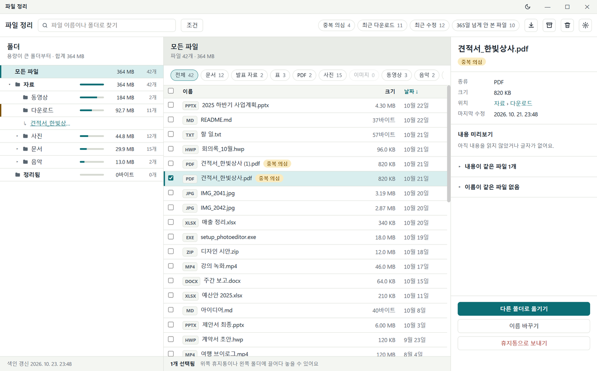
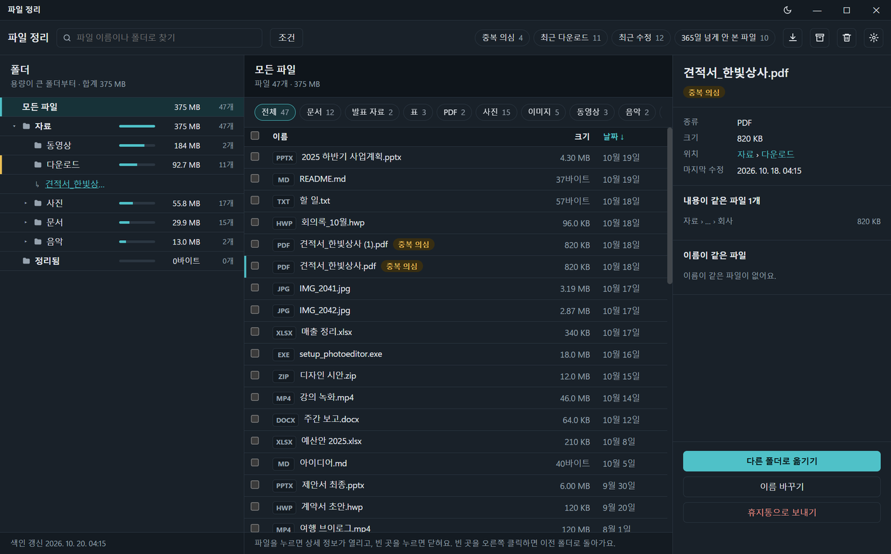
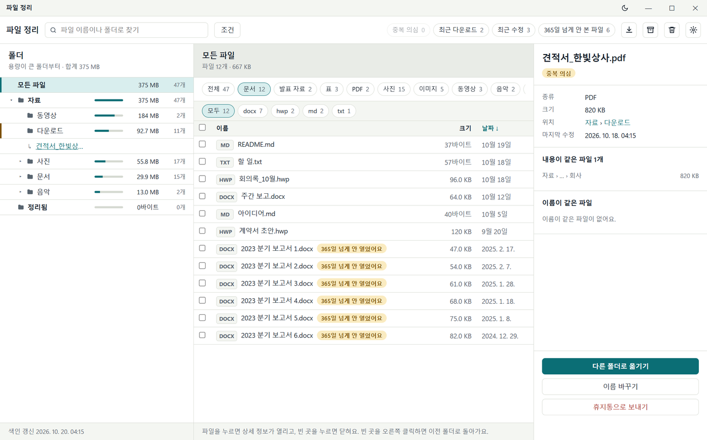
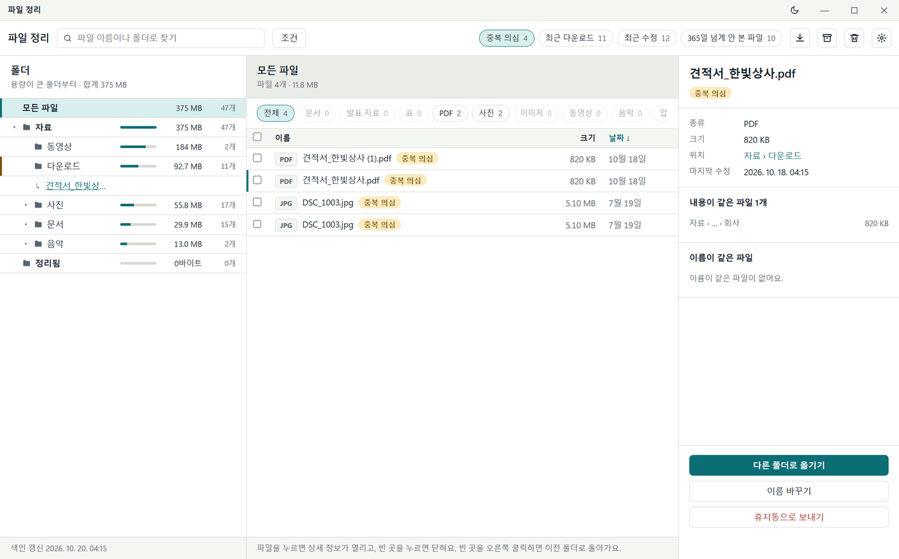
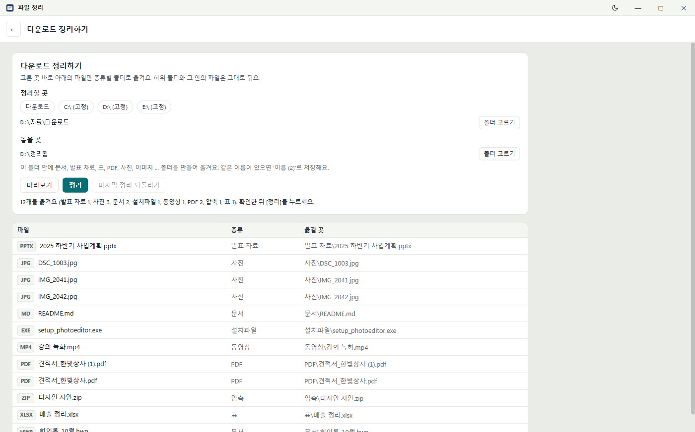
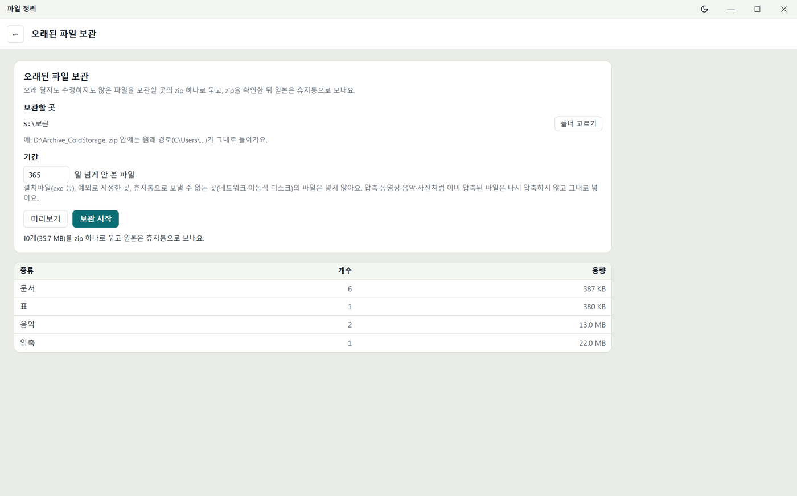
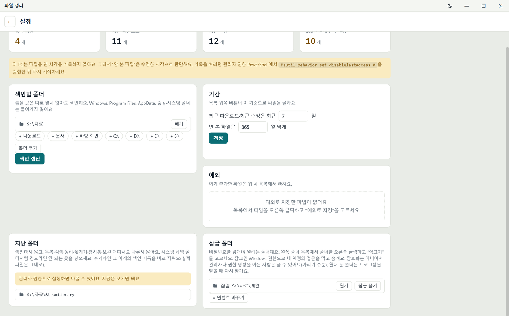
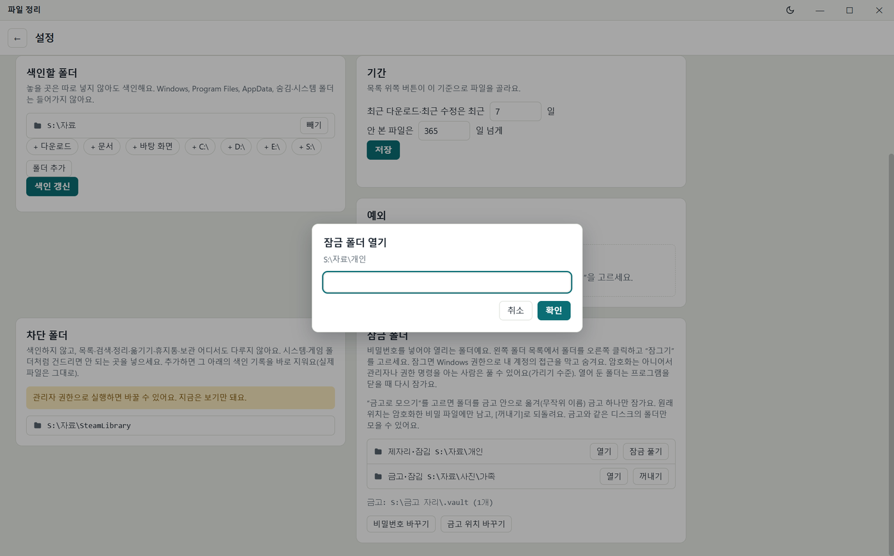
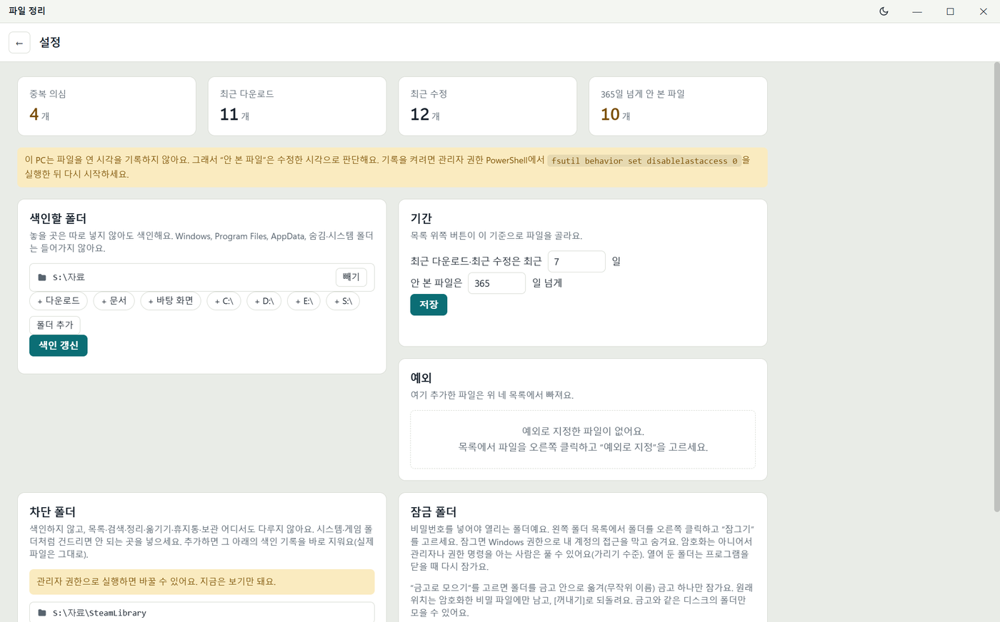

# 파일 정리

다운로드한 파일을 종류별 폴더로 정리하고, 이름·종류·날짜·크기·파일 안의 글자로 찾는 Windows 프로그램입니다.



*(그림의 파일과 폴더는 설명을 위해 지어낸 예시입니다.)*

## 할 수 있는 것

| 하고 싶은 일 | 쓰는 곳 |
|---|---|
| 어느 폴더가 용량을 많이 쓰는지 보기 | 왼쪽 폴더 목록(용량이 큰 폴더부터) |
| 파일 찾기 | 검색창, 종류 칩, [조건] |
| 같은 파일이 여러 개인지 보기 | `중복 의심` 칩 |
| 최근에 받은·고친 파일, 오래 안 본 파일 보기 | `최근 다운로드`·`최근 수정`·`N일 넘게 안 본 파일` 칩 |
| 다운로드 폴더를 종류별로 정리 | ↓ 아이콘(다운로드 정리하기) |
| 오래 안 본 파일을 zip으로 보관 | 상자 아이콘(오래된 파일 보관) |
| 여러 파일 옮기기·휴지통으로 보내기 | 끌어 놓기, 오른쪽 상세의 버튼 |
| 설치한 게임 보기, 게임 스크린샷·녹화 모으기 | 게임패드 아이콘(게임) |
| 오래된 임시 파일·캐시 비우기 | 설정 → 캐시 정리 |
| 그 밖의 폴더도 아예 건드리지 않게 | 설정 → 차단 폴더 |
| 작업 폴더처럼 구조를 바꾸면 안 되는 폴더 지키기 | 설정 → 구조 보호 폴더 |
| 비밀번호를 넣어야 열리는 폴더 | 폴더 오른쪽 클릭 → 잠금… (잠금 창) |

이 프로그램은 파일을 **영구 삭제하지 않습니다**. 지우는 것은 모두 Windows 휴지통으로 갑니다.

## 설치

[Releases](https://github.com/jinhangcho-ops/file_organizer/releases)에서 `file_organizer_setup.exe`를 받아 실행합니다.

- 설치 위치를 고를 수 있습니다(기본: `%LOCALAPPDATA%\Programs\file_organizer`, 관리자 권한 필요 없음).
- [바탕 화면에 바로 가기 만들기]를 체크하면 바탕 화면에 아이콘이 생깁니다. 시작 메뉴에는 늘 생깁니다.
- 설치하는 동안 앱 파일(약 150MB)을 인터넷에서 받고, 받은 파일이 올린 것과 같은지(SHA-256) 확인한 뒤에 설치합니다.
- 지우기는 Windows 설정 → 앱에서 합니다. 설정·색인(`%APPDATA%\file_organizer`)과 인식 모델은 남습니다.

## 시작하기

1. 시작 메뉴나 바탕 화면의 **파일 정리**를 실행합니다.
2. 오른쪽 위 톱니(설정)에서 **색인할 폴더**를 확인합니다. 처음에는 다운로드·문서·바탕 화면이 들어 있습니다. 칩(`+ D:\` 등)이나 [폴더 추가]로 더하고 [빼기]로 뺍니다.
3. [색인 갱신]을 누릅니다. 목록·검색·중복 의심은 모두 이 색인을 읽습니다. 처음 한 번은 시간이 걸리고, 그 뒤로는 바뀐 파일만 다시 읽습니다.

## 화면 둘러보기

- **제목 줄:** 끌면 창이 움직이고, 두 번 누르면 최대화·되돌리기입니다. 오른쪽은 화면 색(라이트·다크), 최소화, 최대화, 닫기입니다. 창 가장자리를 끌면 크기가 바뀝니다.
- **도구 줄:** 검색창, [조건], 필터 칩, 아이콘(다운로드 정리하기, 오래된 파일 보관, 휴지통, 설정). 다른 화면에서는 ←로 목록에 돌아옵니다.
- **왼쪽 폴더 목록:** 폴더마다 그 아래 전체의 **용량**(막대와 숫자)과 파일 수가 나옵니다. 형제끼리는 용량이 큰 폴더부터 놓입니다. 폴더를 누르면 가운데에 탐색기처럼 그 폴더의 **바로 아래 폴더**(용량·파일 수와 함께)와 **바로 든 파일**이 나오고, ▸/▾는 펼치기·접기만 합니다. 검색어·[조건]·모아 보기를 쓰면 그 폴더 아래 전부에서 찾습니다.
  - **가운데의 폴더 줄:** 한 번 누르면 오른쪽에 폴더 설명, 두 번 누르면 그 폴더로 들어갑니다. 파일을 폴더 줄에 끌어 놓으면 그 안으로 옮깁니다.
  - **폴더 설명:** 용량·파일 수·하위 폴더 수, 종류별 구성, 큰 파일 3개, 마지막 수정, 같은 파일 의심 수(색인에서 그때 셉니다)와 **내 메모**(500자). 메모는 앱 안에서 옮기거나 이름을 바꾸면 따라가고, 휴지통으로 보내면 지워집니다.
  - **드라이브:** '폴더' 제목 오른쪽의 [전체 드라이브 ▾]에서 드라이브를 고르면 그 드라이브의 폴더만 나오고, 합계와 가운데 '모든 파일'도 그 드라이브만큼만 셉니다. 고른 드라이브는 기억합니다. 색인한 폴더가 없는 드라이브면 [이 드라이브 색인에 넣기]가 나옵니다(드라이브 전체를 색인할 폴더에 넣고 색인을 시작합니다).
- **가운데 파일 표:** 체크 칸, 이름, 크기(탐색기처럼 KB·MB·GB), 날짜. 머리글을 누르면 정렬됩니다. 이름순은 A-Z 다음 ㄱ-ㅎ입니다. 여러 개를 고르면 아래 줄에 개수와 용량 합계가 나옵니다.
  - **목록 보기(설정):** 여러 폴더의 파일이 섞인 목록을 '폴더별로 묶기'로 바꾸면 폴더마다 제목 줄이 생깁니다. '설치파일을 맨 위에'를 켜면 exe·msi 등이 맨 위에 옵니다(묶었을 때는 폴더 안에서 맨 위). 상세의 '이름이 같은 파일' 칸도 여기서 끕니다.
- **오른쪽 상세:** 파일을 누르면 열립니다. 종류·크기·위치, 옮기기·이름 바꾸기·휴지통 버튼이 있습니다. 빈 곳을 누르면 닫힙니다.
  - **내용 미리보기:** 색인이 읽어 둔 파일 글자의 앞부분(300자)입니다. 따로 저장하지 않아 용량이 늘지 않습니다. 글자를 읽지 않는 형식(사진·동영상·hwp 등)은 그렇다고 알려 줍니다.
  - **받은 곳·편집한 사람:** 브라우저로 받은 파일은 받은 주소와 링크가 있던 페이지(주소의 `?` 뒤와 아이디·비밀번호는 가림), Office 문서는 만든 사람·마지막 저장한 사람, PDF는 작성자, 그리고 파일의 Windows 소유자를 보여 줍니다. 파일을 고를 때 그 파일에서 바로 읽고 저장하지 않습니다. 문서 안의 이름은 그 사람의 Office에 설정된 이름이라 실제 사람과 다를 수 있고, 소유자는 보통 처음 만든 사람입니다.
  - **내용이 같은 파일·이름이 같은 파일:** 처음에는 제목 줄(`▸ 내용이 같은 파일 2개`, `▸ 이름이 같은 파일 없음`)만 보입니다. 누르면 펼쳐지고, 펼친 상태는 다른 파일을 골라도 그대로입니다. 목록의 파일을 누르면 그 파일로 갑니다.
- **칸 너비:** 왼쪽 폴더 목록과 가운데 사이, 가운데와 오른쪽 상세 사이의 경계선을 끌면 너비가 바뀌고, 다시 켜도 그대로입니다. 경계선을 두 번 누르면 기본 너비로 돌아갑니다. 가운데 파일 표는 늘 400px 넘게 남깁니다.

파일을 고르면 왼쪽 목록이 그 파일이 든 폴더까지 펼쳐지고, 폴더 아래에 `↳ 파일 이름` 줄이 붙습니다. 그 줄을 누르면 탐색기가 그 폴더를 열고 파일을 골라 둡니다.

- 파일을 두 번 누르면 열립니다.
- **오른쪽 클릭:** 파일 위에서는 메뉴(열기, 폴더 열기, 예외로 지정), 왼쪽 폴더·가운데 폴더 줄 위에서는 폴더 메뉴(잠금…, 폴더 비우기, 폴더 지우기, 차단 폴더로), 그 밖의 곳에서는 이전 폴더로 돌아갑니다.



## 파일 찾기



- **검색창:** 파일 이름이나 폴더 이름의 일부를 씁니다.
- **종류 칩:** 문서, 발표 자료, 표, PDF, 사진, 이미지, 동영상, 음악, 압축, 설치파일, 기타. 종류를 고르면 그 안의 확장자 칩(예: 문서 → docx, hwp, md, txt)이 한 줄 더 나옵니다. 많이 누른 종류가 왼쪽에 옵니다.
- **[조건]:** 파일 안의 글자, 수정한 날짜 기간, 크기 범위(MB). 쓴 조건은 모두 만족해야 합니다. 글자는 txt·md·csv·json·html 같은 글자 파일과 pdf·docx·xlsx·pptx에서 찾고, 50MB보다 큰 파일은 읽지 않습니다.
- 칩이 한 줄을 넘치면 칩 위에서 마우스 휠을 굴리거나 눌러서 좌우로 끌어 봅니다.

## 중복 의심·최근 다운로드·최근 수정·안 본 파일



도구 줄의 필터 칩을 누르면 지금 목록에서 그 파일만 남고, 다시 누르면 풀립니다. 설정 화면 맨 위의 숫자 카드를 눌러도 됩니다.

- **중복 의심:** 내용이 같은 파일입니다. 크기가 같은 파일끼리만 비교하고, 8MB보다 큰 파일은 앞·가운데·뒤 일부만 비교하므로 '의심'입니다. 지우기 전에 확인하세요.
- **최근 다운로드:** 인터넷에서 받은 파일(Windows의 다운로드 표시가 있는 파일). 정리해서 옮긴 뒤에도 나옵니다.
- **최근 수정:** 정한 기간(기본 7일) 안에 고친 파일.
- **N일 넘게 안 본 파일:** 정한 기간(기본 90일) 넘게 열지도 고치지도 않은 파일.

기간은 설정에서 바꿉니다. **예외**로 지정한 파일·폴더는 이 네 목록에서만 빠집니다(파일 오른쪽 클릭 → 예외로 지정, 설정의 예외 목록에서 [빼기]).

Windows가 파일을 연 시각을 기록하지 않게 돼 있으면 설정에 안내가 나오고, 이때 '안 본 파일'은 수정한 시각으로 판단합니다. 기록을 켜려면 관리자 권한 PowerShell에서 아래를 실행하고 다시 시작합니다.

```bash
fsutil behavior set disablelastaccess 0
```

## 옮기기와 휴지통

- **고르기:** 클릭(그 줄만), 체크 칸·Ctrl+클릭(하나씩), 머리글 체크 칸(모두), Shift+클릭(범위), 빈 곳에서 끌기(사각형 안의 줄).
- **옮기기:** 고른 줄을 왼쪽 폴더에 끌어 놓거나, 오른쪽 상세의 [다른 폴더로 옮기기]로 폴더를 고릅니다. 왼쪽의 폴더도 끌어서 옮길 수 있습니다. 같은 이름이 있으면 덮어쓰지 않고 `이름 (2)`가 됩니다.
- **되돌리기(Ctrl+Z):** 옮기기·이름 바꾸기·다운로드 정리를 최근 것부터 하나씩 원래 자리로 되돌립니다(프로그램을 켜 둔 동안 최근 20개). 원래 자리에 같은 이름이 생겼거나 그사이 차단·잠근 곳이면 그 파일은 그대로 두고 알립니다. 휴지통으로 보낸 것은 Windows 휴지통의 [복원]으로 꺼냅니다. 검색 칸 같은 입력 칸 안에서는 글자 되돌리기입니다.
- **휴지통:** 도구 줄의 휴지통 아이콘에 끌어 놓거나 [휴지통으로 보내기]를 누르면 확인 창이 뜨고, [확인]을 눌러야 보냅니다.
- 휴지통으로 보낼 수 없는 곳(네트워크·이동식 디스크, 휴지통을 끈 디스크, 휴지통 최대 크기보다 큰 것)은 영구 삭제될 수 있으므로 보내지 않고 까닭을 알립니다. 휴지통 최대 크기 설정이 없는 디스크(새로 단 디스크 등)는 디스크 크기의 5%를 최대 크기로 봅니다.

### 폴더 비우기·지우기

- **폴더 비우기:** 안의 파일·폴더를 모두 휴지통으로 보내고 폴더는 남깁니다. 보내기 전에 개수를 보여 주고 확인을 받습니다. 숨김·시스템 파일(desktop.ini 등)은 그대로 둡니다. 차단·잠금 폴더가 든 것은 그 항목만 빼고, 구조 보호 폴더와 드라이브 전체는 비우지 않습니다.
- **폴더 지우기:** 폴더를 통째로 휴지통으로 보냅니다(색인한 맨 위 폴더는 지우지 않습니다).

## 다운로드 정리하기



1. **정리할 곳**을 고릅니다(다운로드, 디스크, 또는 [폴더 고르기]).
2. **놓을 곳**을 고릅니다. 그 안에 `문서`, `발표 자료`, `표`, `PDF`, `사진`, `이미지`, `동영상`, `음악`, `압축`, `설치파일`, `기타` 폴더가 생깁니다.
3. [미리보기]로 어디로 가는지 확인하고 [정리]를 누릅니다.

- 고른 곳 **바로 아래의 파일만** 옮깁니다. 하위 폴더는 그대로 둡니다.
- 받는 중인 파일(`.crdownload`, `.part` 등)과 숨김·시스템 파일은 옮기지 않습니다.
- 프로그램 부품(`.dll`, `.sys`, `.pak`, `.ini` 등)은 옮기지 않고, 부품이 함께 있으면 `.exe`도 그대로 둡니다. 압축을 푼 게임·프로그램이 종류별 폴더로 흩어지지 않게 하려는 것입니다.
- 게임 캡처(Xbox Game Bar·NVIDIA가 붙이는 '게임 이름 날짜 시각' 모양의 이름)는 종류별 폴더 대신 [게임 캡처 정리](#게임)와 같은 게임별 폴더로 갑니다.
- 다른 디스크로 옮길 때는 복사한 뒤 크기를 확인하고 나서 원본을 지웁니다. 폴더를 옮길 때는 복사한 파일만 지웁니다. 옮기는 동안 새로 생기거나 바뀐 파일은 원래 폴더에 남기고 알려 줍니다.
- [마지막 정리 되돌리기]로 바로 전의 정리를 원래 자리로 돌립니다. 그사이 차단하거나 잠근 폴더 안의 파일은 되돌리지 않고 기록에 남겨 둡니다(풀고 나서 다시 되돌릴 수 있습니다).

## 오래된 파일 보관



1. **보관할 곳**을 고릅니다(예: `D:\Archive_ColdStorage`).
2. **기간**을 정합니다(기본 365일). 연 시각과 수정 시각 중 늦은 쪽이 이보다 오래된 파일이 대상입니다.
3. [미리보기]로 종류별 개수·용량을 보고 [보관 시작]을 누릅니다.

- 실행할 때마다 zip 하나(`2026-10-19_1530.zip`)를 만들고, 안에 원래 경로(`C/Users/…`)를 살려 넣습니다.
- zip을 다시 열어 모든 파일을 확인한 뒤에만 원본을 휴지통으로 보냅니다. **휴지통을 비워야 공간이 생깁니다.**
- 설치파일, 예외로 지정한 곳, 게임 폴더와 Windows·프로그램 폴더, 휴지통으로 보낼 수 없는 곳의 파일은 넣지 않습니다. 이미 압축된 파일(동영상·사진·압축 등)은 다시 압축하지 않습니다.

## 게임

도구 줄의 게임패드 아이콘을 누릅니다.

- **설치한 게임:** 색인할 때 찾은 게임 폴더와 Steam·Epic Games·GOG·Ubisoft Connect에 설치한 게임을 이름·런처·크기·마지막 실행(Steam)·폴더로 보여 줍니다. 설치했는지 잊은 게임을 찾을 때 씁니다. 이름을 누르면 탐색기에서 그 폴더를 엽니다. 크기를 모르는 것은 [모르는 크기 세기]로 셉니다. 지우려면 그 게임의 런처나 Windows 설정 → 앱에서 제거하세요.
- **게임 폴더 판별:** 색인은 폴더를 훑으면서 게임 폴더인지만 판별하고 그 안은 읽지 않습니다. 런처의 기록, 게임에만 있는 파일(`steam_api64.dll`, `UnityPlayer.dll`, Unreal 게임의 `Engine` 폴더 등), 게임 폴더 이름(`SteamLibrary`, `Riot Games`, `XboxGames` 등)으로 판별합니다. 그래서 게임 파일은 파일 목록·검색·중복 의심에 나오지 않습니다. 이것들에 걸리지 않는 게임은 차단 폴더로 막으세요.
- **게임·Windows 폴더 지키기:** 게임 폴더와 Windows·Program Files·ProgramData·AppData 안의 것은 옮기기·이름 바꾸기·휴지통·폴더 비우기를 하지 않습니다. 게임 폴더가 든 폴더도 통째로 옮기거나 지우지 않습니다. 놓을 곳·보관할 곳으로도 고를 수 없습니다.
- **게임 캡처 정리:** [미리보기]로 게임마다 몇 개가 어디로 가는지 보고 [옮기기]를 누릅니다. 스크린샷은 `사진\스크린샷\게임 이름`, 영상은 `동영상\게임 녹화\게임 이름`으로 갑니다. 같은 이름이 있으면 ' (2)'를 붙이고, Ctrl+Z로 되돌릴 수 있습니다.

| 어디서 | 찾는 곳 | 게임 이름 |
|---|---|---|
| Xbox Game Bar | `동영상\Captures` | 파일 이름의 앞부분 |
| NVIDIA | `동영상\게임 이름` | 파일 이름의 앞부분 |
| AMD | `동영상\Radeon ReLive\게임 이름` | 폴더 이름 |
| Steam | Steam 폴더의 `userdata\…\760\remote\번호\screenshots` | 설치한 게임이면 이름, 아니면 'Steam 게임 번호' |

옮기면 Steam·Game Bar의 갤러리에서는 보이지 않습니다.

## 캐시 정리

설정 → 캐시 정리에서 일수를 정하고 [살펴보기]를 누르면, 캐시마다 그 일수보다 오래 고치지 않은 것의 크기와 개수가 나옵니다. 묶음(Windows 임시 폴더, 브라우저 캐시, 앱 캐시)과 그 안의 캐시마다 체크하고, [휴지통으로 보내기] → [확인]을 누릅니다. 체크는 기억합니다.

| 묶음 | 캐시 |
|---|---|
| Windows 임시 폴더 | `%TEMP%` |
| 브라우저 캐시 | Edge·Chrome·Firefox의 캐시 폴더(프로필마다) |
| 앱 캐시 | Discord, Teams, Slack, VS Code, Spotify(이 PC에 있는 것만 나옵니다) |

- 지우는 것은 모두 **휴지통**으로 갑니다. 휴지통을 비워야 디스크 자리가 늡니다.
- 그 프로그램이 켜져 있으면 그 캐시는 건너뛰고 알려 줍니다. 닫은 뒤 다시 하세요.
- 숨김·시스템 파일, 링크, 차단·잠금·구조 보호 폴더 안은 건드리지 않습니다. 쓰는 중이라 보낼 수 없는 파일은 그대로 두고 알려 줍니다.

## 차단 폴더



Windows 폴더와 게임 폴더는 따로 넣지 않아도 지킵니다([게임](#게임)). 그 밖에 **정리하면 안 되는 폴더**를 넣어 둡니다. 차단한 폴더와 그 아래 전부는:

- 색인하지 않습니다. 넣는 순간 지금까지의 색인 기록도 지웁니다(실제 파일은 그대로).
- 목록·검색·중복 의심에 나오지 않습니다.
- 정리·옮기기·이름 바꾸기·휴지통·보관 어디서도 다루지 않습니다. 그 안을 정리할 곳·놓을 곳·보관할 곳·색인할 폴더로 고를 수도 없습니다.
- 차단 폴더가 **들어 있는** 위 폴더도 옮기거나, 이름을 바꾸거나, 휴지통으로 보낼 수 없습니다.
- 색인하는 동안이나 옮기기·휴지통·정리·보관이 도는 동안에는 차단·구조 보호·잠금 폴더를 바꾸지 않습니다(끝난 뒤에 하세요).

**관리자 권한으로 실행했을 때만 바꿀 수 있습니다**(exe를 오른쪽 클릭 → 관리자 권한으로 실행). 보통으로 실행하면 목록을 보기만 합니다.

- 설정 → 차단 폴더의 [폴더 추가], 또는 왼쪽 폴더를 오른쪽 클릭 → [차단 폴더로].
- [게임 폴더 찾기]를 누르면 색인하는 드라이브에서 `SteamLibrary`, `Epic Games`, `Riot Games`, `XboxGames`, `Battle.net` 같은 폴더를 찾아 후보로 보여 줍니다. 눌러야 추가됩니다.
- 목록은 `C:\ProgramData\file_organizer\blacklist.json`에 있고, 관리자만 고칠 수 있게 권한을 맞춰 둡니다.
- Windows, Program Files, AppData, 숨김·시스템 폴더는 차단하지 않아도 처음부터 색인하지 않습니다.

## 구조 보호 폴더

작업 폴더처럼 **안의 구조를 바꾸면 안 되는 폴더**를 넣어 둡니다. 차단 폴더와 달리 색인·목록·검색·미리보기·열기는 그대로 됩니다.

| 하는 일 | 구조 보호 폴더 자신(과 그것이 든 위 폴더) | 안의 파일·폴더 |
|---|---|---|
| 옮기기 | 거부 | 됩니다(밖으로 옮기기) |
| 이름 바꾸기 | 거부 | 거부 |
| 휴지통으로 보내기 | 거부 | 거부 |
| 오래된 파일 보관 | - | 넣지 않습니다(원본을 휴지통으로 보내므로) |

- 밖의 파일을 안으로 옮겨 넣는 것은 됩니다.
- 차단 폴더처럼 **관리자 권한으로 실행했을 때만** 바꿀 수 있습니다. 설정 → 구조 보호 폴더의 [폴더 추가], 또는 왼쪽 폴더를 오른쪽 클릭 → [구조 보호 폴더로].
- 목록은 `C:\ProgramData\file_organizer\protected.json`에 있고, 차단 목록처럼 관리자만 고칠 수 있게 권한을 맞춰 둡니다.

## 잠금 폴더

![폴더 오른쪽 클릭 메뉴(그림은 예전 메뉴: 지금은 [잠금…] 한 줄)](docs/folder-menu.png)

비밀번호를 넣어야 열리는 폴더입니다. 잠그는 방법이 두 가지입니다.

- **잠그기(제자리):** 폴더가 있던 자리에서 그대로 잠급니다.
- **금고로 모으기:** 폴더를 금고 폴더 안으로 옮기고 금고 하나만 잠급니다. 금고 안에서는 `504960fc…` 같은 무작위 이름이 되어, 금고를 열어 봐도 무엇인지 바로 알 수 없습니다. 원래 이름과 위치는 비밀 파일에만 남습니다.

### 쓰는 법

잠금은 모두 따로 뜨는 **잠금 창**에서 합니다(설정 → 잠금 폴더의 [잠금 창 열기], 또는 폴더 오른쪽 클릭 → [잠금…]). 잠금 창은 **화면 공유·녹화·캡처에 나오지 않습니다**(창 하나 공유든 화면 전체 공유든, 공유받는 쪽에는 검게 보이거나 빠집니다. Windows 10 2004 이상이 필요하고, 그보다 오래된 Windows에서는 잠금 창을 열지 않습니다).

1. 잠금 창에서 [비밀번호 정하기](4자 이상).
2. 금고를 쓰려면 [금고 위치 정하기]로 금고를 둘 곳을 고릅니다. 그 안에 숨긴 `.vault` 폴더가 생깁니다. 금고와 **같은 디스크**의 폴더만 모을 수 있습니다(다른 디스크로는 복사 후 원본 삭제가 되어서, 하지 않습니다).
3. 왼쪽 폴더 목록에서 폴더를 오른쪽 클릭 → [잠금…] → 잠금 창의 [잠그기] 또는 [금고로 모으기] → 비밀번호.
4. 잠금 창의 목록에서:
   - [열기]: 비밀번호를 넣으면 탐색기로 열립니다(금고의 것이면 금고를 잠시 엽니다). 다 보면 [다시 잠그기]. 이때 열린 탐색기 창은 Windows의 창이라 화면 공유에 나옵니다.
   - [꺼내기](금고): 원래 자리로 되돌립니다. 같은 이름이 있으면 `이름 (2)`로 둡니다. 원래 위 폴더가 없어졌으면 꺼낼 폴더를 고르라고 묻습니다.
   - 금고에 든 폴더의 원래 자리에 같은 이름의 새 폴더를 만들었다면, 그 새 폴더는 금고 것을 꺼내거나 이름을 바꾼 뒤에 잠글 수 있습니다.
   - [잠금 풀기](제자리): 잠금을 아주 풉니다. 다음 [색인 갱신]부터 목록에 다시 나옵니다.
5. 열어 둔 채로 프로그램을 닫아도 다시 잠급니다. 프로그램이 비정상으로 끝났으면(PC 끄기, 강제 종료) 다음에 켤 때 다시 잠급니다.



### 잠그면

- Windows 권한으로 **내 계정의 접근을 거부**합니다. 탐색기에서 열거나 안의 파일을 읽고 쓰고 지울 수 없습니다.
- 숨김·시스템 속성을 켜서 탐색기에 보통은 보이지 않습니다.
- 이 프로그램의 목록과 검색에서 빠집니다.
- 잠금 목록(원래 위치, 금고 안 이름)과 비밀번호의 해시는 비밀 파일 `%APPDATA%\file_organizer\lock.dat` 하나에 둡니다. 숨긴 파일이고, Windows DPAPI로 암호화해 이 Windows 계정으로 로그인했을 때만 읽힙니다. 비밀번호 자체는 저장하지 않습니다.

### 잠금 폴더가 든 폴더를 다룰 때

| 하는 일 | 잠금 폴더(또는 금고)가 들어 있으면 |
|---|---|
| 같은 디스크 안에서 옮기기, 이름 바꾸기 | 됩니다. 비밀 파일의 위치도 새 위치로 고칩니다(금고에 든 폴더의 원래 위치도 함께). |
| 다른 디스크로 옮기기 | 거부합니다(잠긴 내용은 복사할 수 없어서). |
| 휴지통으로 보내기 | 거부합니다(휴지통을 비우면 잠긴 내용까지 사라져서). |

프로그램 밖(탐색기)에서 옮긴 것은 따라갈 수 없습니다. 목록에 `찾을 수 없음`으로 나오고, [잠금 풀기]로 목록에서 뺄 수 있습니다.

**한계:** 파일을 암호화하지 않습니다. 관리자, 다른 OS로 부팅한 사람, 아래 명령을 아는 사람은 풀 수 있는 '가리기' 수준입니다. 꼭 지켜야 하는 파일은 BitLocker 같은 암호화를 쓰세요. OneDrive로 동기화하는 폴더는 잠근 동안 동기화 오류가 날 수 있습니다.

### 비밀번호를 잊었을 때

PowerShell에서 아래를 실행하면 잠금이 풀립니다(`D:\개인`을 잠근 폴더나 금고(`…\.vault`) 경로로 바꿉니다).

```powershell
icacls "D:\개인" /remove:d "$env:USERNAME"
```

```powershell
attrib -h -s "D:\개인"
```

그 뒤 `%APPDATA%\file_organizer\lock.dat`을 지우면 목록과 비밀번호가 처음 상태가 됩니다(다른 잠금 폴더도 먼저 같은 명령으로 푸세요). 금고 안의 폴더는 이름이 무작위라, `lock.dat`을 지우면 원래 이름과 위치를 알 수 없습니다. 금고를 열어 내용을 보고 직접 옮기세요.

## 화면 공유할 때

- **창 하나만 공유해도 보입니다:** 대화상자, 오른쪽 클릭 메뉴, 알림, 마우스를 올리면 뜨는 설명, 폴더·파일 고르기 창, 끌 때의 '○개 항목 이동 중' 표시. 모두 앱 창 안에 그립니다.
- **공유에 나오지 않습니다:** 잠금 창(비밀번호, 잠금 목록, 금고). 공유받는 쪽에는 검게 보이거나 빠집니다.
- **다른 프로그램의 창:** [폴더 열기]로 뜨는 탐색기나 파일을 여는 프로그램은 그 창을 함께 공유해야 보입니다.

## 색인

- 놓을 곳은 따로 넣지 않아도 색인합니다.
- ① 파일 목록 ② 중복 확인 ③ 파일 내용 읽기 순서로 합니다. ①이 끝나면 목록은 바로 쓸 수 있고, ②·③은 뒤에서 이어집니다. 진행 상황은 왼쪽 아래에 나옵니다.
- 2초마다 저장하므로, 색인 중에 창을 닫거나 [멈추기]를 눌러도 거기까지는 남고 다음에 이어서 합니다.
- 프로그램 안에서 한 정리·옮기기·이름 바꾸기·휴지통은 색인에 바로 반영됩니다. 그 밖에 바뀐 것은 [색인 갱신]을 눌러야 반영됩니다.
- 색인은 `%APPDATA%\file_organizer\index.db`에 있습니다.



## 소스에서 실행하기

```bash
python -m venv .venv
```

```bash
.venv\Scripts\pip install -r requirements.txt
```

```bash
.venv\Scripts\python desktop.py
```

exe 만들기(`dist\file_organizer\file_organizer.exe`):

```bash
.venv\Scripts\pip install pyinstaller
```

```bash
.venv\Scripts\pyinstaller file_organizer.spec
```

설치 프로그램 만들기(`dist\file_organizer_setup.exe`, [Inno Setup 6.7](https://jrsoftware.org/isinfo.php) 필요). 앱 파일을 zip으로 묶은 뒤 컴파일합니다. 만든 zip(`dist\file_organizer.zip`)은 Releases의 `v1.0.0`에 그대로 올립니다. 설치 프로그램이 컴파일할 때 그 zip의 SHA-256을 넣어 두고, 받은 파일과 비교하기 때문입니다.

```bash
.venv\Scripts\python -c "import shutil; shutil.make_archive('dist/file_organizer', 'zip', 'dist/file_organizer')"
```

```bash
"%LOCALAPPDATA%\Programs\Inno Setup 6\ISCC.exe" installer.iss
```

## 검사

```bash
.venv\Scripts\python tests.py
```

```bash
.venv\Scripts\python -m pytest
```

pytest는 개발용이라 `requirements.txt`에 없습니다(`pip install pytest`). 둘 다 임시 폴더에 만든 파일로만 확인하며 실제 설정과 파일, 실제 휴지통은 건드리지 않습니다. 잠금 폴더 검사는 임시 폴더에 실제 Windows 권한을 걸었다 풉니다. 다른 디스크로 옮기는 것까지 확인하려면 `OTHER_DRIVE` 환경 변수에 디스크(예: `D:\`)를 줍니다.
