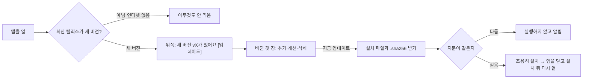
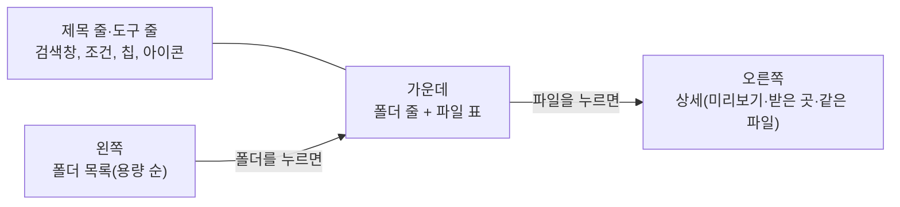
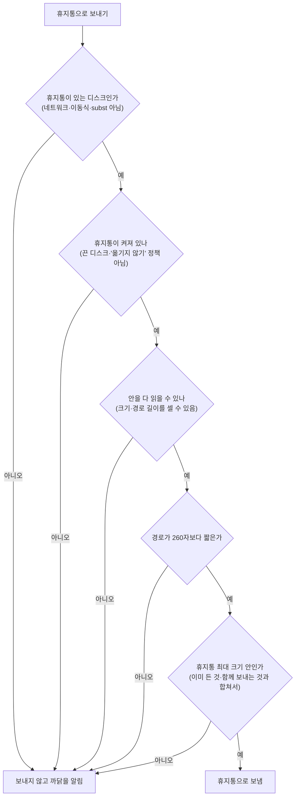
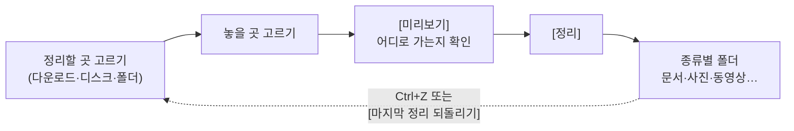
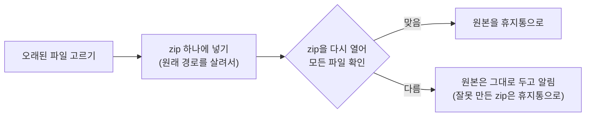
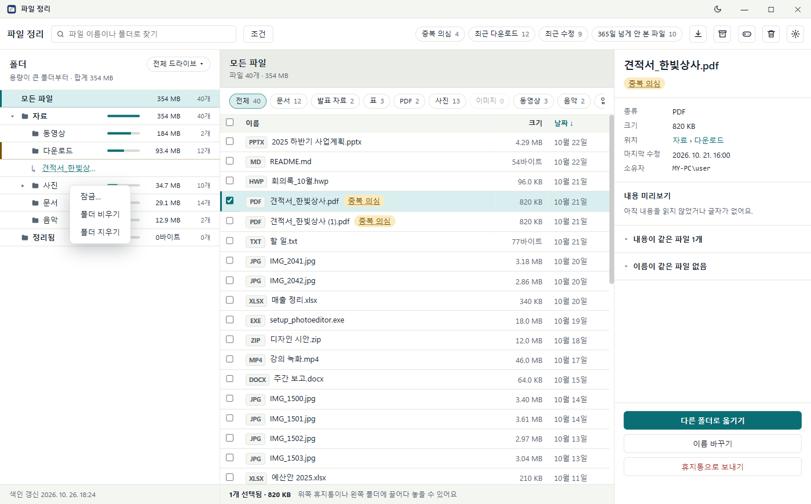
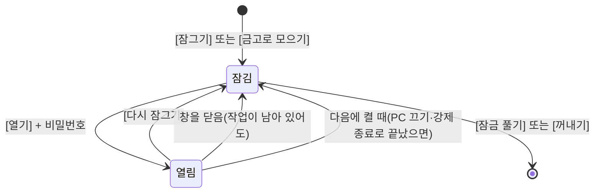
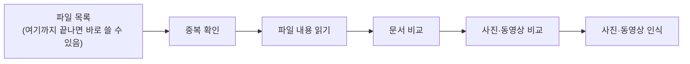

# 파일 정리

다운로드한 파일을 종류별 폴더로 정리하고, 이름·종류·날짜·크기·파일 안의 글자로 찾는 Windows 프로그램입니다.


*(그림의 파일과 폴더는 설명을 위해 지어낸 예시입니다.)*

> 이 프로그램은 파일을 **영구 삭제하지 않습니다**. 지우는 것은 모두 Windows 휴지통으로 갑니다.

## 할 수 있는 것

| 하고 싶은 일 | 쓰는 곳 |
|---|---|
| 어느 폴더가 용량을 많이 쓰는지 보기 | 왼쪽 폴더 목록(용량이 큰 폴더부터) |
| 파일 찾기 | 검색창, 종류 칩, [조건] |
| 파일에 태그 달고 태그로 찾기 | 오른쪽 상세의 태그 줄, 검색창에 `#태그` |
| 같은 파일이 여러 개인지 보기 | `중복 의심` 칩 |
| 최근에 받은·고친 파일, 오래 안 본 파일 보기 | `최근 다운로드`·`최근 수정`·`N일 넘게 안 본 파일` 칩 |
| 다운로드 폴더를 종류별로 정리 | ↓ 아이콘(다운로드 정리하기) |
| 오래 안 본 파일을 zip으로 보관 | 상자 아이콘(오래된 파일 보관) |
| 여러 파일 옮기기·휴지통으로 보내기 | 끌어 놓기, 오른쪽 상세의 버튼 |
| 설치한 게임 보기, 게임 스크린샷·녹화 모으기 | 게임패드 아이콘(게임) |
| 오래된 임시 파일·캐시 비우기 | 설정 → 캐시 정리 |
| 그 밖의 폴더도 아예 건드리지 않게 | 설정 → 차단 폴더 |
| 작업 폴더처럼 구조를 바꾸면 안 되는 폴더 지키기 | 설정 → 구조 보호 폴더 |
| 비밀번호를 넣어야 열리는 폴더 | 폴더 오른쪽 클릭 → 잠금… (잠금 창) |

## 설치

[Releases](https://github.com/jinhangcho-ops/file_organizer/releases)에서 `file_organizer_setup.exe`를 받아 실행합니다.

| 항목 | 내용 |
|---|---|
| 설치 위치 | 고를 수 있습니다. 기본은 `%LOCALAPPDATA%\Programs\file_organizer`이고 관리자 권한이 필요 없습니다. |
| 바로 가기 | 시작 메뉴에는 늘 생깁니다. [바탕 화면에 바로 가기 만들기]를 체크하면 바탕 화면에도 생깁니다. |
| 받는 것 | 설치하는 동안 앱 파일(약 150MB)을 인터넷에서 받고, 올린 것과 같은지(SHA-256) 확인한 뒤에 설치합니다. |
| 지우기 | Windows 설정 → 앱에서 합니다. 설정·색인(`%APPDATA%\file_organizer`)과 인식 모델은 남습니다. |

### 받은 설치 파일 확인하기

Releases에는 파일마다 같은 이름에 `.sha256`을 붙인 지문 파일이 있습니다(예: `file_organizer_setup.exe.sha256`).

- 지문 파일에는 SHA-256 지문과 파일 이름이 적혀 있습니다. 지문은 파일 내용으로 계산한 64글자입니다.
- 파일이 한 글자라도 바뀌면 지문이 완전히 달라집니다. 그래서 받는 도중이나 중간에서 파일이 바뀌지 않았는지 확인할 수 있습니다.

1. `file_organizer_setup.exe`와 `file_organizer_setup.exe.sha256`을 같은 폴더에 받습니다.
2. 그 폴더에서 PowerShell을 열고 아래 한 줄을 실행합니다. `True`가 나오면 만든 그 파일입니다.

```powershell
(Get-FileHash .\file_organizer_setup.exe).Hash -eq (Get-Content .\file_organizer_setup.exe.sha256).Split()[0]
```

- `False`가 나오면 실행하지 말고 다시 받으세요.
- 눈으로 비교하려면 `Get-FileHash .\file_organizer_setup.exe`를 실행하고, 나온 Hash를 `.sha256` 파일의 값과 비교합니다(대소문자는 상관없습니다).
- 앱 파일(`file_organizer.zip`)은 설치 프로그램이 받을 때 스스로 지문을 확인하므로 따로 하지 않아도 됩니다.
- **한계:** 지문과 파일을 같은 Releases 페이지에서 받으므로, 저장소 계정이 털려 둘 다 바뀐 경우까지는 잡지 못합니다.

### 새 버전 알림·업데이트



| 항목 | 내용 |
|---|---|
| 바깥으로 보내는 것 | 앱을 열 때 한 번 GitHub의 최신 릴리스 주소를 열어 봅니다. 새 버전이면 그 릴리스 노트(`RELEASE_NOTES.md`)를 받고, [지금 업데이트]를 누르면 설치 파일과 지문 파일을 받습니다. 파일 이름·설정 같은 내 정보는 보내지 않습니다(GitHub은 이 PC의 인터넷 주소를 압니다). |
| 끄기 | 설정 → 새 버전 알림에서 [앱을 열 때 새 버전 확인]을 끄면 GitHub에 아무것도 묻지 않습니다. |
| 묻지 않을 때 | 설치하지 않고 소스로 실행할 때, 태그 없이 만든 시험 빌드(0.0.0)일 때입니다. 인터넷이 없으면 조용히 넘어갑니다. |
| [지금 업데이트] | 작업이나 색인이 돌고 있거나 설치 드라이브에 1GB가 비어 있지 않으면 하지 않습니다. 지문이 같을 때만 설치를 조용히 시작하고, 앱을 닫았다가 설치가 끝나면 다시 엽니다. 설정·색인은 그대로입니다. |
| 받는 곳 | 늘 이 저장소의 GitHub 릴리스입니다. 설치한 프로그램은 환경 변수 등으로 받는 곳을 바꿀 수 없고, 이번에 알린 새 버전만 설치합니다(옛 판으로 되돌리지 않습니다). |
| 바뀐 것 | 릴리스마다 [CHANGELOG.md](CHANGELOG.md)의 추가·개선·삭제를 릴리스 노트로 올립니다. |

## 시작하기

1. 시작 메뉴나 바탕 화면의 **파일 정리**를 실행합니다.
2. 오른쪽 위 톱니(설정)에서 **색인할 폴더**를 확인합니다.
   - 처음에는 다운로드·문서·바탕 화면이 들어 있습니다.
   - 칩(`+ D:\` 등)이나 [폴더 추가]로 더하고 [빼기]로 뺍니다.
   - 정션·링크 폴더를 고르면(색인할 폴더, 정리할 곳·놓을 곳, 보관할 곳 모두) 그 폴더가 가리키는 실제 폴더가 저장되고, 목록에도 그 경로가 나옵니다.
3. [색인 갱신]을 누릅니다.
   - 목록·검색·중복 의심은 모두 이 색인을 읽습니다.
   - 처음 한 번은 시간이 걸리고, 그 뒤로는 바뀐 파일만 다시 읽습니다.

## 화면 둘러보기



### 제목 줄

- 끌면 창이 움직이고, 두 번 누르면 최대화·되돌리기입니다. 창 가장자리를 끌면 크기가 바뀝니다.
- 오른쪽 버튼은 화면 색, 최소화, 최대화, 닫기입니다.
  - 화면 색은 라이트·다크를 고릅니다. Windows와 같은 색을 고르면 다시 Windows 색을 따릅니다.
- **작업 중에 닫기:**

| 돌고 있는 작업 | 닫기를 누르면 |
|---|---|
| 파일을 바꾸는 작업(옮기기·정리·보관·휴지통으로 보내기 등) | 묻습니다. 닫으면 창은 바로 닫히고, 작업은 끝까지 마친 뒤 프로그램이 꺼집니다. 그동안 다시 켜면 잠시 뒤에 켜 달라고 알려 줍니다. |
| 캐시 살펴보기·게임 크기 세기·모델 받기 | 묻지 않고 그대로 멈춥니다. 모델 받기는 다음에 받을 때 받다 만 임시 파일부터 지웁니다. |
| 열어 둔 잠금 폴더 | 창을 닫을 때 바로 다시 잠급니다. |

- **한 번에 하나만:**
  - 이미 켜져 있을 때 다시 켜면 열려 있는 창을 앞으로 가져옵니다. 최소화했으면 되돌립니다.
  - 관리자 권한으로 켠 창처럼 되돌릴 수 없으면 이미 켜져 있다는 안내를 띄웁니다.
  - 관리자 권한으로 켠 프로그램도 알아봅니다.

### 도구 줄

검색창, [조건], 필터 칩, 아이콘(다운로드 정리하기, 오래된 파일 보관, 게임, 휴지통, 설정)이 있습니다. 다른 화면에서는 ←로 목록에 돌아옵니다.

### 왼쪽 폴더 목록

- 폴더마다 그 아래 전체의 **용량**(막대와 숫자)과 파일 수가 나옵니다. 형제끼리는 용량이 큰 폴더부터 놓입니다.
- 폴더를 누르면 가운데에 탐색기처럼 그 폴더의 **바로 아래 폴더**(용량·파일 수와 함께)와 **바로 든 파일**이 나옵니다. ▸/▾는 펼치기·접기만 합니다.
- 검색어·[조건]·모아 보기를 쓰면 그 폴더 아래 전부에서 찾습니다.
- **가운데의 폴더 줄:** 한 번 누르면 오른쪽에 폴더 설명, 두 번 누르면 그 폴더로 들어갑니다. 파일을 폴더 줄에 끌어 놓으면 그 안으로 옮깁니다.
- **폴더 설명:**
  - 용량·파일 수·하위 폴더 수, 종류별 구성, 큰 파일 3개, 마지막 수정, 같은 파일 의심 수(색인에서 그때 셉니다)가 나옵니다.
  - **내 메모**(500자)를 쓸 수 있습니다. 앱 안에서 옮기거나 이름을 바꾸면 따라가고, 휴지통으로 보내면 지워집니다.
- **드라이브:**
  - '폴더' 제목 오른쪽의 [전체 드라이브 ▾]에서 드라이브를 고르면 그 드라이브의 폴더만 나옵니다. 합계와 가운데 '모든 파일'도 그 드라이브만큼만 셉니다.
  - 고른 드라이브는 기억합니다.
  - 색인한 폴더가 없는 드라이브면 [이 드라이브 색인에 넣기]가 나옵니다. 드라이브 전체를 색인할 폴더에 넣고 색인을 시작합니다.

### 가운데 파일 표

- 체크 칸, 이름, 크기(탐색기처럼 KB·MB·GB), 날짜가 있습니다. 머리글을 누르면 정렬됩니다. 이름순은 A-Z 다음 ㄱ-ㅎ입니다.
- 여러 개를 고르면 아래 줄에 개수와 용량 합계가 나옵니다.
- **목록 보기(설정):**
  - '폴더별로 묶기': 여러 폴더의 파일이 섞인 목록에서 폴더마다 제목 줄이 생깁니다.
  - '설치파일을 맨 위에': exe·msi 등이 맨 위에 옵니다(묶었을 때는 폴더 안에서 맨 위).
  - 상세의 '이름이 같은 파일' 칸도 여기서 끕니다.

### 오른쪽 상세

파일을 누르면 열리고, 빈 곳을 누르면 닫힙니다. 종류·크기·위치, 옮기기·이름 바꾸기·휴지통 버튼이 있습니다.

| 칸 | 보여 주는 것 |
|---|---|
| 내용 미리보기 | 색인이 읽어 둔 파일 글자의 앞부분(300자). 따로 저장하지 않아 용량이 늘지 않습니다. 글자를 읽지 않는 형식(사진·동영상·hwp 등)은 그렇다고 알려 줍니다. |
| 받은 곳 | 브라우저로 받은 파일의 받은 주소와 링크가 있던 페이지. 주소의 `?` 뒤와 아이디·비밀번호는 가립니다. |
| 편집한 사람 | Office 문서의 만든 사람·마지막 저장한 사람, PDF의 작성자, 파일의 Windows 소유자 |
| 내용이 같은 파일·이름이 같은 파일 | 처음에는 제목 줄(`▸ 내용이 같은 파일 2개`)만 보입니다. 누르면 펼쳐지고, 펼친 상태는 다른 파일을 골라도 그대로입니다. 목록의 파일을 누르면 그 파일로 갑니다. |

- 받은 곳과 편집한 사람은 파일을 고를 때 그 파일에서 바로 읽고, 저장하지 않습니다.
- **태그 줄:** 파일에 `#코딩` 같은 태그를 달 수 있습니다.
  - 태그 칸에 적고 Enter를 누르면 달립니다. 앞의 `#`는 있어도 없어도 됩니다(1~50자, 한 줄).
  - 태그 칩을 누르면 그 태그가 달린 파일만 모아 봅니다. 칩의 ×로 지웁니다.
  - 여러 파일을 골랐으면 고른 것 모두에 달리거나 지워집니다.
  - 앱 안에서 옮기거나 이름을 바꾸면 따라갑니다. 휴지통에서 되돌리거나 다시 색인해도 남습니다.
  - **앱 밖(탐색기)에서 옮기거나 이름을 바꾸면 따라가지 않습니다.** 폴더에는 달 수 없습니다.
- 문서 안의 이름은 그 사람의 Office에 설정된 이름이라 실제 사람과 다를 수 있습니다. 소유자는 보통 처음 만든 사람입니다.

### 그 밖의 조작

- **칸 너비:**
  - 왼쪽과 가운데 사이, 가운데와 오른쪽 사이의 경계선을 끌면 너비가 바뀌고, 다시 켜도 그대로입니다.
  - 경계선을 두 번 누르면 기본 너비로 돌아갑니다.
  - 가운데 파일 표는 늘 400px 넘게 남깁니다.
- **고른 파일 따라가기:** 파일을 고르면 왼쪽 목록이 그 파일이 든 폴더까지 펼쳐지고, 폴더 아래에 `↳ 파일 이름` 줄이 붙습니다. 그 줄을 누르면 탐색기가 그 폴더를 열고 파일을 골라 둡니다.
- **두 번 누르기:** 파일이 열립니다.
  - 열면 실행되는 파일(`.exe .msi .bat .cmd .lnk .url .js .vbs .ps1 .hta .reg` 등)은 실행하지 않고 탐색기에서 골라 보여 줍니다. 받은 파일 `견적서.pdf.lnk`를 문서로 알고 눌러 실행하는 일을 막습니다. 설치하려면 탐색기에서 직접 실행하세요.
- **오른쪽 클릭:**

| 어디서 | 나오는 것 |
|---|---|
| 파일 위 | 열기, 폴더 열기, 예외로 지정 |
| 왼쪽 폴더·가운데 폴더 줄 위 | 잠금…, 폴더 비우기, 폴더 지우기, (관리자 권한이면) 차단 폴더로·구조 보호 폴더로 |
| 그 밖의 곳 | 이전 폴더로 돌아가기 |


## 파일 찾기


| 찾는 방법 | 쓰는 법 |
|---|---|
| 검색창 | 파일 이름이나 그 파일이 바로 든 폴더 이름의 일부를 씁니다(더 위 폴더의 이름으로는 찾지 않습니다). |
| 태그 | 검색창에 `#코딩`처럼 치면 그 태그가 달린 파일만 나옵니다. |
| 종류 칩 | 문서, 발표 자료, 표, PDF, 사진, 이미지, 동영상, 음악, 압축, 설치파일, 기타. 종류를 고르면 그 안의 확장자 칩(예: 문서 → docx, hwp, md, txt)이 한 줄 더 나옵니다. 많이 누른 종류가 왼쪽에 옵니다. |
| [조건] | 파일 안의 글자, 수정한 날짜 기간, 크기 범위(MB). 쓴 조건은 모두 만족해야 합니다. |

- 파일 안의 글자는 txt·md·csv·json·html 같은 글자 파일과 pdf·docx·xlsx·pptx에서 찾습니다. 50MB보다 큰 파일은 읽지 않습니다.
- 칩이 한 줄을 넘치면 칩 위에서 마우스 휠을 굴리거나 눌러서 좌우로 끌어 봅니다.

## 중복 의심·최근 다운로드·최근 수정·안 본 파일


도구 줄의 필터 칩을 누르면 지금 목록에서 그 파일만 남고, 다시 누르면 풀립니다. 설정 화면 맨 위의 숫자 카드를 눌러도 됩니다.

| 칩 | 나오는 파일 |
|---|---|
| 중복 의심 | 내용이 같은 파일. 색인 단계를 켜 두면 문서 정보만 다른 문서, 글자가 같은 문서, 보이는 내용이 같은 사진·동영상(크기가 달라도)도 나옵니다. |
| 최근 다운로드 | 인터넷에서 받은 파일(Windows의 다운로드 표시가 있는 파일). 정리해서 옮긴 뒤에도 나옵니다. |
| 최근 수정 | 정한 기간(기본 7일) 안에 고친 파일 |
| N일 넘게 안 본 파일 | 정한 기간(기본 90일) 넘게 열지도 고치지도 않은 파일 |

- **중복 '의심'인 까닭:** 크기가 같은 파일끼리만 비교하고, 8MB보다 큰 파일은 앞·가운데·뒤 일부만 비교합니다. 지우기 전에 확인하세요.
- 기간은 설정에서 바꿉니다.
- **예외**로 지정한 파일·폴더는 이 네 목록에서만 빠집니다(파일 오른쪽 클릭 → 예외로 지정, 설정의 예외 목록에서 [빼기]).
- Windows가 파일을 연 시각을 기록하지 않게 돼 있으면 설정에 안내가 나오고, 이때 '안 본 파일'은 수정한 시각으로 판단합니다. 기록을 켜려면 관리자 권한 PowerShell에서 아래를 실행하고 다시 시작합니다.

```bash
fsutil behavior set disablelastaccess 0
```

## 옮기기와 휴지통

### 고르기

| 하는 법 | 고르는 것 |
|---|---|
| 클릭 | 그 줄만 |
| 체크 칸, Ctrl+클릭 | 하나씩 더하기 |
| 머리글 체크 칸 | 모두 |
| Shift+클릭 | 범위 |
| 빈 곳에서 끌기 | 사각형 안의 줄 |

### 옮기기

- 고른 줄을 왼쪽 폴더에 끌어 놓거나, 오른쪽 상세의 [다른 폴더로 옮기기]로 폴더를 고릅니다. 왼쪽의 폴더도 끌어서 옮길 수 있습니다.
- 같은 이름이 있으면 덮어쓰지 않고 `이름 (2)`가 됩니다.
- **Windows가 다룰 수 없는 이름:** 끝이 점(`.`)이나 빈칸인 이름, `CON`·`NUL`·`COM1` 같은 장치 이름은 Windows가 다른 파일로 읽을 수 있습니다. 그래서 옮기기·이름 바꾸기·휴지통·정리에서 다루지 않고, 새 이름으로도 쓸 수 없습니다.

### 되돌리기(Ctrl+Z)

- 옮기기·이름 바꾸기·다운로드 정리를 최근 것부터 하나씩 원래 자리로 되돌립니다(프로그램을 켜 둔 동안 최근 20개).
- 원래 자리에 같은 이름이 생겼거나 그사이 차단·잠근 곳이면 그 파일은 그대로 두고 알립니다.
- 휴지통으로 보낸 것은 Windows 휴지통의 [복원]으로 꺼냅니다.
- 검색 칸 같은 입력 칸 안에서는 글자 되돌리기입니다.

### 휴지통

도구 줄의 휴지통 아이콘에 끌어 놓거나 [휴지통으로 보내기]를 누르면 확인 창이 뜨고, [확인]을 눌러야 보냅니다.

보내기 전에 아래를 차례로 확인합니다. 하나라도 걸리면 **영구 삭제될 수 있으므로 보내지 않고** 까닭을 알립니다.



- 경로가 260자 이상인 파일은 휴지통에 들어가지 않고 그대로 지워지므로 막습니다.
- 휴지통 최대 크기를 넘기면 Windows가 먼저 넣은 것을 말없이 비우므로 막습니다.
- 휴지통 최대 크기 설정이 없는 디스크(새로 단 디스크 등)는 디스크 크기의 5%를 최대 크기로 봅니다.

### 폴더 비우기·지우기

| 메뉴 | 하는 일 | 하지 않는 것 |
|---|---|---|
| 폴더 비우기 | 안의 파일·폴더를 모두 휴지통으로 보내고 폴더는 남깁니다. 보내기 전에 개수를 보여 주고 확인을 받습니다. | 숨김·시스템 파일(desktop.ini 등)은 둡니다. 차단·잠금 폴더가 든 것은 그 항목만 뺍니다. 구조 보호 폴더와 드라이브 전체는 비우지 않습니다. |
| 폴더 지우기 | 폴더를 통째로 휴지통으로 보냅니다. | 색인한 맨 위 폴더는 지우지 않습니다. |

## 다운로드 정리하기




1. **정리할 곳**을 고릅니다(다운로드, 디스크, 또는 [폴더 고르기]).
2. **놓을 곳**을 고릅니다. 그 안에 `문서`, `발표 자료`, `표`, `PDF`, `사진`, `이미지`, `동영상`, `음악`, `압축`, `설치파일`, `기타` 폴더가 생깁니다.
3. [미리보기]로 어디로 가는지 확인하고 [정리]를 누릅니다.

**옮기는 것과 옮기지 않는 것**

| 옮김 | 옮기지 않음 |
|---|---|
| 고른 곳 **바로 아래의 파일** | 하위 폴더 |
| | 받는 중인 파일(`.crdownload`, `.part` 등), 숨김·시스템 파일 |
| | 프로그램 부품(`.dll`, `.sys`, `.pak`, `.ini` 등)과 부품이 함께 있는 `.exe`. 압축을 푼 게임·프로그램이 흩어지지 않게 하려는 것입니다. |
| 게임 캡처('게임 이름 날짜 시각' 모양의 이름) → [게임 캡처 정리](#게임)와 같은 게임별 폴더 | |

- **다른 디스크로 옮길 때:**
  - 복사한 뒤 크기를 확인하고 나서 원본을 지웁니다. 폴더를 옮길 때는 복사한 파일만 지웁니다.
  - 옮기는 동안 새로 생기거나 바뀐 파일은 원래 자리에 남기고 알려 줍니다.
  - 링크·정션이 든 폴더는 다른 디스크로 옮기지 않습니다(가리키는 곳의 파일까지 옮겨지기 때문입니다).
- **되돌리기:** [마지막 정리 되돌리기]로 바로 전의 정리를 원래 자리로 돌립니다. 그사이 차단하거나 잠근 폴더 안의 파일은 되돌리지 않고 기록에 남겨 둡니다(풀고 나서 다시 되돌릴 수 있습니다).

## 오래된 파일 보관


1. **보관할 곳**을 고릅니다(예: `D:\Archive_ColdStorage`).
2. **기간**을 정합니다(기본 365일). 연 시각과 수정 시각 중 늦은 쪽이 이보다 오래된 파일이 대상입니다.
3. [미리보기]로 종류별 개수·용량을 보고 [보관 시작]을 누릅니다.



- 실행할 때마다 zip 하나(`2026-10-19_1530.zip`)를 만들고, 안에 원래 경로(`C/Users/…`)를 살려 넣습니다.
- **휴지통을 비워야 공간이 생깁니다.**
- 넣지 않는 것: 설치파일, 클라우드 전용(OneDrive 온라인 전용) 파일, 예외로 지정한 곳, 게임 폴더와 Windows·프로그램 폴더, 휴지통으로 보낼 수 없는 곳의 파일.
- 이미 압축된 파일(동영상·사진·압축 등)은 다시 압축하지 않습니다.

## 게임

도구 줄의 게임패드 아이콘을 누릅니다.

### 설치한 게임

- 색인할 때 찾은 게임 폴더와 Steam·Epic Games·GOG·Ubisoft Connect에 설치한 게임을 이름·런처·크기·마지막 실행(Steam)·폴더로 보여 줍니다. 설치했는지 잊은 게임을 찾을 때 씁니다.
- 이름을 누르면 탐색기에서 그 폴더를 엽니다. 크기를 모르는 것은 [모르는 크기 세기]로 셉니다.
- 지우려면 그 게임의 런처나 Windows 설정 → 앱에서 제거하세요.

### 게임 폴더 판별과 지키기

- 색인은 폴더를 훑으면서 게임 폴더인지만 판별하고, 그 안은 읽지 않습니다. 그래서 게임 파일은 파일 목록·검색·중복 의심에 나오지 않습니다.

| 판별하는 근거 | 예 |
|---|---|
| 런처의 기록 | Steam·Epic Games·GOG·Ubisoft Connect |
| 게임에만 있는 파일 | `steam_api64.dll`, `UnityPlayer.dll`, Unreal 게임의 `Engine` 폴더 |
| 게임 폴더 이름 | `SteamLibrary`, `Riot Games`, `XboxGames` |

- 이것들에 걸리지 않는 게임은 차단 폴더로 막으세요.
- 게임 폴더와 Windows·Program Files·ProgramData·AppData 안의 것은 옮기기·이름 바꾸기·휴지통·폴더 비우기를 하지 않고, 그 안에 새 폴더도 만들지 않습니다.
- 게임 폴더가 든 폴더도 통째로 옮기거나 지우지 않습니다. 놓을 곳·보관할 곳으로도 고를 수 없습니다.

### 게임 캡처 정리

[미리보기]로 게임마다 몇 개가 어디로 가는지 보고 [옮기기]를 누릅니다.

| 캡처 | 가는 곳 |
|---|---|
| 스크린샷 | `사진\스크린샷\게임 이름` |
| 영상 | `동영상\게임 녹화\게임 이름` |

- 같은 이름이 있으면 ' (2)'를 붙이고, Ctrl+Z로 되돌릴 수 있습니다.
- 옮기면 Steam·Game Bar의 갤러리에서는 보이지 않습니다.

| 어디서 | 찾는 곳 | 게임 이름 |
|---|---|---|
| Xbox Game Bar | `동영상\Captures` | 파일 이름의 앞부분 |
| NVIDIA | `동영상\게임 이름` | 파일 이름의 앞부분 |
| AMD | `동영상\Radeon ReLive\게임 이름` | 폴더 이름 |
| Steam | Steam 폴더의 `userdata\…\760\remote\번호\screenshots` | 설치한 게임이면 이름, 아니면 'Steam 게임 번호' |

## 캐시 정리

1. 설정 → 캐시 정리에서 일수를 정하고 [살펴보기]를 누릅니다. 캐시마다 그 일수보다 오래 고치지 않은 것의 크기와 개수가 나옵니다.
2. 묶음과 그 안의 캐시마다 체크합니다. 체크는 기억합니다.
3. [휴지통으로 보내기] → [확인]을 누릅니다.

| 묶음 | 캐시 |
|---|---|
| Windows 임시 폴더 | `%TEMP%` |
| 브라우저 캐시 | Edge·Chrome·Firefox의 캐시 폴더(프로필마다) |
| 앱 캐시 | Discord, Teams, Slack, VS Code, Spotify(이 PC에 있는 것만 나옵니다) |

- 지우는 것은 모두 **휴지통**으로 갑니다. 휴지통을 비워야 디스크 자리가 늡니다.
- 그 프로그램이 켜져 있으면 그 캐시는 건너뛰고 알려 줍니다. 닫은 뒤 다시 하세요.
- 숨김·시스템 파일, 링크, 차단·잠금·구조 보호 폴더 안은 건드리지 않습니다. 쓰는 중이라 보낼 수 없는 파일은 그대로 두고 알려 줍니다.
- `%TEMP%`가 드라이브 맨 위, 사용자 폴더를 품은 곳, 다운로드·문서·바탕 화면(이나 그 안·그것을 품은 곳)을 가리키면 그 캐시는 없는 것으로 봅니다.

## 지키는 폴더 세 가지

Windows 폴더와 게임 폴더는 따로 넣지 않아도 지킵니다([게임](#게임)). 그 밖의 폴더는 아래 세 가지로 지킵니다.

| | 차단 폴더 | 구조 보호 폴더 | 잠금 폴더 |
|---|---|---|---|
| 쓰는 때 | 아예 건드리면 안 되는 폴더 | 작업 폴더처럼 안의 구조를 바꾸면 안 되는 폴더 | 비밀번호를 넣어야 열려야 하는 폴더 |
| 색인·목록·검색 | 나오지 않음 | 그대로 나옴 | 나오지 않음(열어 둔 동안도) |
| 미리보기·열기 | 안 됨 | 됨 | 잠금 창에서 비밀번호를 넣고 탐색기나 [잠금 파일 보기]로 열기 |
| 그 폴더를 옮기기 | 안 됨 | 안 됨 | 목록에 없어 앱에서는 못 고름 |
| 안의 것 이름 바꾸기·휴지통(앱에서) | 안 됨 | 안 됨 | 안 됨 |
| 그 폴더가 든 위 폴더를 옮기기 | 안 됨 | 안 됨 | 같은 디스크 안에서만 됨 |
| 그 폴더가 든 위 폴더를 휴지통으로 | 안 됨 | 안 됨 | 안 됨 |
| 오래된 파일 보관 | 넣지 않음 | 넣지 않음 | 넣지 않음 |
| 바꾸는 사람 | 관리자 권한으로 실행했을 때만 | 관리자 권한으로 실행했을 때만 | 잠금 창(비밀번호) |

색인하는 동안이나 옮기기·휴지통·정리·보관이 도는 동안에는 이 세 목록을 바꾸지 않습니다(끝난 뒤에 하세요).

## 차단 폴더


**정리하면 안 되는 폴더**를 넣어 둡니다. 차단한 폴더와 그 아래 전부는:

- 색인하지 않습니다. 넣는 순간 지금까지의 색인 기록도 지웁니다(실제 파일은 그대로).
- 목록·검색·중복 의심에 나오지 않습니다.
- 정리·옮기기·이름 바꾸기·휴지통·보관 어디서도 다루지 않습니다. 그 안을 정리할 곳·놓을 곳·보관할 곳·색인할 폴더로 고를 수도 없습니다.
- 차단 폴더가 **들어 있는** 위 폴더도 옮기거나, 이름을 바꾸거나, 휴지통으로 보낼 수 없습니다.

**넣는 법** (관리자 권한으로 실행했을 때만: exe를 오른쪽 클릭 → 관리자 권한으로 실행. 보통으로 실행하면 목록을 보기만 합니다)

- 설정 → 차단 폴더의 [폴더 추가], 또는 왼쪽 폴더를 오른쪽 클릭 → [차단 폴더로].
- [게임 폴더 찾기]를 누르면 색인하는 드라이브에서 `SteamLibrary`, `Epic Games`, `Riot Games`, `XboxGames`, `Battle.net` 같은 폴더를 찾아 후보로 보여 줍니다. 눌러야 추가됩니다.
- 목록은 `C:\ProgramData\file_organizer\blacklist.json`에 있고, 관리자만 고칠 수 있게 권한을 맞춰 둡니다.
- Windows, Program Files, AppData, 숨김·시스템 폴더는 차단하지 않아도 처음부터 색인하지 않습니다.

**한계:** 프로그램은 내 계정이 고칠 수 있는 폴더(기본 `%LOCALAPPDATA%\Programs\file_organizer`)에 설치됩니다.

- 그래서 관리자 권한으로 실행하면, 보통 권한의 다른 프로그램이 바꿔 놓았을 수도 있는 파일을 관리자 권한으로 돌리게 됩니다.
- 목록을 바꿀 때만 관리자 권한으로 실행하고, 믿을 수 없는 프로그램은 이 PC에서 실행하지 마세요.

## 구조 보호 폴더

작업 폴더처럼 **안의 구조를 바꾸면 안 되는 폴더**를 넣어 둡니다. 차단 폴더와 달리 색인·목록·검색·미리보기·열기는 그대로 됩니다.

| 하는 일 | 구조 보호 폴더 자신(과 그것이 든 위 폴더) | 안의 파일·폴더 |
|---|---|---|
| 옮기기 | 거부 | 됩니다(밖으로 옮기기) |
| 이름 바꾸기 | 거부 | 거부 |
| 휴지통으로 보내기 | 거부 | 거부 |
| 오래된 파일 보관 | - | 넣지 않습니다(원본을 휴지통으로 보내므로) |

- 밖의 파일을 안으로 옮겨 넣는 것은 됩니다.
- 차단 폴더처럼 **관리자 권한으로 실행했을 때만** 바꿀 수 있습니다. 설정 → 구조 보호 폴더의 [폴더 추가], 또는 왼쪽 폴더를 오른쪽 클릭 → [구조 보호 폴더로].
- 목록은 `C:\ProgramData\file_organizer\protected.json`에 있고, 차단 목록처럼 관리자만 고칠 수 있게 권한을 맞춰 둡니다.

## 잠금 폴더



비밀번호를 넣어야 열리는 폴더입니다. 잠그는 방법이 두 가지입니다.

| 방법 | 하는 일 |
|---|---|
| 잠그기(제자리) | 폴더가 있던 자리에서 그대로 잠급니다. |
| 금고로 모으기 | 폴더를 금고 폴더 안으로 옮기고 금고 하나만 잠급니다. 금고 안에서는 `504960fc…` 같은 무작위 이름이 되어, 금고를 열어 봐도 무엇인지 바로 알 수 없습니다. 원래 이름과 위치는 비밀 파일에만 남습니다. |



### 쓰는 법

잠금은 모두 따로 뜨는 **잠금 창**에서 합니다(설정 → 잠금 폴더의 [잠금 창 열기], 또는 폴더 오른쪽 클릭 → [잠금…]).

- 잠금 창은 **화면 공유·녹화·캡처에 나오지 않습니다**. 창 하나 공유든 화면 전체 공유든, 공유받는 쪽에는 검게 보이거나 빠집니다.
- Windows 10 2004 이상이 필요합니다. 그보다 오래된 Windows에서는 잠금 창을 열지 않습니다.

1. 잠금 창에서 [비밀번호 정하기](8자 이상. 예전 판에서 정한 짧은 비밀번호도 그대로 맞고, 바꿀 때만 8자 이상). 틀리면 1초 뒤에 다시 넣을 수 있습니다.
2. 금고를 쓰려면 [금고 위치 정하기]로 금고를 둘 곳을 고릅니다.
   - 그 안에 숨긴 `.vault` 폴더가 생깁니다.
   - 금고와 **같은 디스크**의 폴더만 모을 수 있습니다(다른 디스크로는 복사 후 원본 삭제가 되어서, 하지 않습니다).
3. 왼쪽 폴더 목록에서 폴더를 오른쪽 클릭 → [잠금…] → 잠금 창의 [잠그기] 또는 [금고로 모으기] → 비밀번호.
4. 잠금 창의 목록에서:

| 버튼 | 하는 일 |
|---|---|
| [열기] | 비밀번호를 넣으면 탐색기로 열립니다(금고의 것이면 금고를 잠시 엽니다). 다 보면 [다시 잠그기]. 이때 열린 탐색기 창은 Windows의 창이라 화면 공유에 나옵니다. |
| [꺼내기](금고) | 원래 자리로 되돌립니다. 같은 이름이 있으면 `이름 (2)`로 둡니다. 원래 위 폴더가 없어졌으면 꺼낼 폴더를 고르라고 묻습니다. |
| [잠금 풀기](제자리) | 잠금을 아주 풉니다. 다음 [색인 갱신]부터 목록에 다시 나옵니다. |

- 금고에 든 폴더의 원래 자리에 같은 이름의 새 폴더를 만들었다면, 그 새 폴더는 금고 것을 꺼내거나 이름을 바꾼 뒤에 잠글 수 있습니다.


### 실제로 잠겼는지 확인

잠금 창을 열 때마다 잠겨 있어야 할 폴더(금고는 금고)를 하나씩 확인합니다. [다시 확인]을 누르면 다시 봅니다.

| 목록에 보이는 것 | 뜻 |
|---|---|
| `잠김(확인함)` | 숨김·시스템 속성이 켜져 있고, 내 계정으로 폴더 안을 열면 Windows가 막습니다. |
| `잠금이 풀려 있음`(노란 줄) | 기록은 잠김인데, 실제로는 안을 열 수 있거나 숨겨져 있지 않습니다. 앱 밖에서 권한을 고쳤거나(icacls, 탐색기의 보안 탭) 잠그다 중간에 실패한 경우입니다. [다시 잠그기]를 누르면 다시 잠급니다. |
| `열림` | 비밀번호로 열어 둔 상태라 확인하지 않습니다. |

### 잠금 파일 보기

잠금 폴더가 하나라도 있으면 잠금 창 위쪽에 [잠금 관리 / 잠금 파일 보기] 전환이 나옵니다. [잠금 파일 보기]는 잠금 폴더 안의 파일만 보여 줍니다.

| 하는 일 | 방법 |
|---|---|
| 잠긴 폴더 안 보기 | 잠금 폴더 줄을 누르고 비밀번호를 넣습니다. 탐색기는 띄우지 않고 이 창에서 보여 줍니다. |
| 하위 폴더로 / 위로 | 폴더 줄을 누릅니다 / [↑ 위로] |
| 파일 열기 | 파일 줄을 두 번 누르면 연결된 프로그램으로 엽니다(열면 실행되는 파일은 탐색기에서 골라 보여 줍니다). 열린 프로그램의 창은 화면 공유에 나옵니다. |
| 다 본 뒤 | [잠금 관리]에서 [다시 잠그기]. 창을 닫을 때도 다시 잠급니다. |

- 이 화면도 잠금 창 안이라 화면 공유·녹화·캡처에 나오지 않습니다.
- 금고에 든 폴더도 원래 위치 이름으로 보여 줍니다(금고 안의 무작위 이름은 보이지 않습니다).
- 잠금 폴더 밖을 가리키는 링크·정션은 보여 주지 않습니다.

### 잠그면

- Windows 권한으로 **내 계정의 접근을 거부**합니다. 탐색기에서 열거나 안의 파일을 읽고 쓰고 지울 수 없습니다.
- 숨김·시스템 속성을 켜서 탐색기에 보통은 보이지 않습니다.
- 이 프로그램의 목록과 검색에서 빠집니다.
- 잠금 목록(원래 위치, 금고 안 이름)과 비밀번호의 해시는 비밀 파일 `%APPDATA%\file_organizer\lock.dat` 하나에 둡니다.
  - 숨긴 파일이고, Windows DPAPI로 암호화해 이 Windows 계정으로 로그인했을 때만 읽힙니다.
  - 비밀번호 자체는 저장하지 않습니다.

### 잠금 폴더가 든 폴더를 다룰 때

| 하는 일 | 잠금 폴더(또는 금고)가 들어 있으면 |
|---|---|
| 같은 디스크 안에서 옮기기, 이름 바꾸기 | 됩니다. 비밀 파일의 위치도 새 위치로 고칩니다(금고에 든 폴더의 원래 위치도 함께). |
| 다른 디스크로 옮기기 | 거부합니다(잠긴 내용은 복사할 수 없어서). |
| 휴지통으로 보내기 | 거부합니다(휴지통을 비우면 잠긴 내용까지 사라져서). |

프로그램 밖(탐색기)에서 옮긴 것은 따라갈 수 없습니다. 목록에 `찾을 수 없음`으로 나오고, [잠금 풀기]로 목록에서 뺄 수 있습니다.

**한계:**

- 파일을 암호화하지 않습니다. 관리자, 다른 OS로 부팅한 사람, 아래 명령을 아는 사람은 풀 수 있는 '가리기' 수준입니다. 꼭 지켜야 하는 파일은 BitLocker 같은 암호화를 쓰세요.
- OneDrive로 동기화하는 폴더는 잠근 동안 동기화 오류가 날 수 있습니다.

### 비밀번호를 잊었을 때

PowerShell에서 아래를 실행하면 잠금이 풀립니다(`D:\개인`을 잠근 폴더나 금고(`…\.vault`) 경로로 바꿉니다).

```powershell
icacls "D:\개인" /remove:d "$env:USERNAME"
```

```powershell
attrib -h -s "D:\개인"
```

- 그 뒤 `%APPDATA%\file_organizer\lock.dat`을 지우면 목록과 비밀번호가 처음 상태가 됩니다(다른 잠금 폴더도 먼저 같은 명령으로 푸세요).
- 금고 안의 폴더는 이름이 무작위라, `lock.dat`을 지우면 원래 이름과 위치를 알 수 없습니다. 금고를 열어 내용을 보고 직접 옮기세요.

## 화면 공유할 때

| | 무엇 |
|---|---|
| 창 하나만 공유해도 보입니다 | 대화상자, 오른쪽 클릭 메뉴, 알림, 마우스를 올리면 뜨는 설명, 폴더·파일 고르기 창, 끌 때의 '○개 항목 이동 중' 표시(모두 앱 창 안에 그립니다) |
| 공유에 나오지 않습니다 | 잠금 창(비밀번호, 잠금 목록, 금고). 공유받는 쪽에는 검게 보이거나 빠집니다. |
| 그 창을 함께 공유해야 보입니다 | [폴더 열기]로 뜨는 탐색기, 파일을 여는 프로그램 |

## 색인

먼저 파일 목록을 만들고, 이어서 설정의 색인 단계를 설정한 순서대로 합니다. 단계는 설정에서 켜고 끄고 순서를 바꿀 수 있습니다.



*(단계 순서는 기본값의 예입니다. 목록 다음의 단계는 뒤에서 이어지고, 진행 상황은 왼쪽 아래에 나옵니다.)*

- 놓을 곳은 따로 넣지 않아도 색인합니다.
- 2초마다 저장하므로, 색인 중에 창을 닫거나 [멈추기]를 눌러도 거기까지는 남고 다음에 이어서 합니다.
- 색인할 폴더가 지금 없으면(외장 디스크를 뺐거나 네트워크가 끊긴 경우) 그 아래 기록은 지우지 않고 둡니다. 다시 연결하면 그대로 이어집니다.
- 프로그램 안에서 한 정리·옮기기·이름 바꾸기·휴지통은 색인에 바로 반영됩니다. 그 밖에 바뀐 것은 [색인 갱신]을 눌러야 반영됩니다.
- 색인은 `%APPDATA%\file_organizer\index.db`에 있습니다. 태그도 이 파일에 파일 경로로 함께 저장합니다.


## 소스에서 실행하기

```bash
python -m venv .venv
```

```bash
.venv\Scripts\pip install -r requirements.txt
```

```bash
.venv\Scripts\python desktop.py
```

exe 만들기(`dist\file_organizer\file_organizer.exe`):

```bash
.venv\Scripts\pip install pyinstaller
```

```bash
.venv\Scripts\pyinstaller file_organizer.spec
```

릴리스(GitHub Actions, `.github/workflows/release.yml`):

1. [CHANGELOG.md](CHANGELOG.md)에 `## v1.0.2` 절을 쓰고 `### 추가`·`### 개선`·`### 삭제` 세 칸을 채웁니다(바뀐 것이 없으면 `- 없음`). 검사가 형식을 봅니다.
2. `v1.0.2` 같은 태그를 올리면 시험 → exe → 앱 파일 zip → 설치 파일(`/DAppVersion=1.0.2`)을 만들고, 설치 파일·zip·각각의 `.sha256`·`RELEASE_NOTES.md`를 릴리스에 올립니다. 그 절이 없으면 실패합니다. 같은 태그로 다시 돌리면 파일을 바꿔 올립니다.

PC에서 직접 만들 때(`dist\file_organizer_setup.exe`, [Inno Setup 6.7](https://jrsoftware.org/isinfo.php) 필요):

1. 앱 파일을 zip으로 묶습니다. 설치 프로그램은 컴파일할 때 그 zip의 SHA-256을 넣어 두고, 설치할 때 Releases의 그 버전에서 zip을 받아 비교합니다. 그래서 같은 zip을 같은 버전에 올려야 합니다.

```bash
.venv\Scripts\python -c "import shutil; shutil.make_archive('dist/file_organizer', 'zip', 'dist/file_organizer')"
```

2. 버전을 넣어 컴파일합니다. 버전을 빼면 0.0.0이 되고, 그 판은 새 버전 알림을 하지 않습니다.

```bash
"%LOCALAPPDATA%\Programs\Inno Setup 6\ISCC.exe" /DAppVersion=1.0.2 installer.iss
```

## 검사

```bash
.venv\Scripts\python tests.py
```

```bash
.venv\Scripts\python -m pytest
```

- pytest는 개발용이라 `requirements.txt`에 없습니다(`pip install pytest`).
- 둘 다 임시 폴더에 만든 파일로만 확인하며 실제 설정과 파일, 실제 휴지통은 건드리지 않습니다.
- 잠금 폴더 검사는 임시 폴더에 실제 Windows 권한을 걸었다 풉니다.
- 다른 디스크로 옮기는 것까지 확인하려면 `OTHER_DRIVE` 환경 변수에 디스크(예: `D:\`)를 줍니다.

## 라이선스

GPL-3.0입니다(`LICENSE`). 고치거나 다시 배포할 수 있고, 배포할 때는 소스 코드도 같은 조건으로 공개해야 합니다.

exe에는 FFmpeg(GPL-3.0), HEIC를 읽는 x265(GPL-2.0)·libheif(LGPL-3.0) 등 다른 사람이 만든 부품이 함께 들어 있습니다.

- 부품마다의 라이선스와 소스 코드를 받을 곳: `THIRD_PARTY_NOTICES.md`
- 라이선스 원문: `THIRD_PARTY_LICENSES.txt`
- 설치한 폴더의 `_internal`에도 같은 파일이 있습니다.
